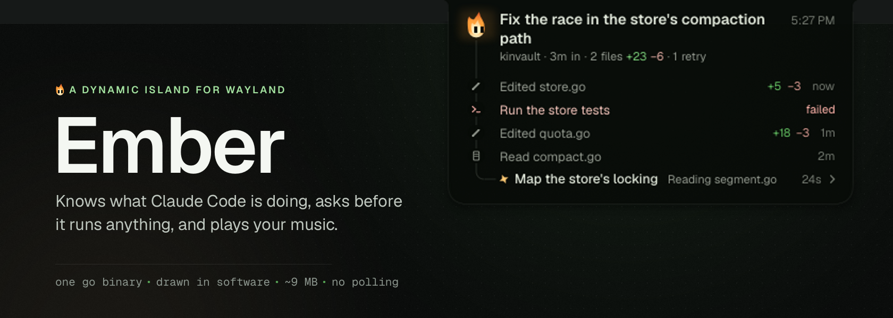
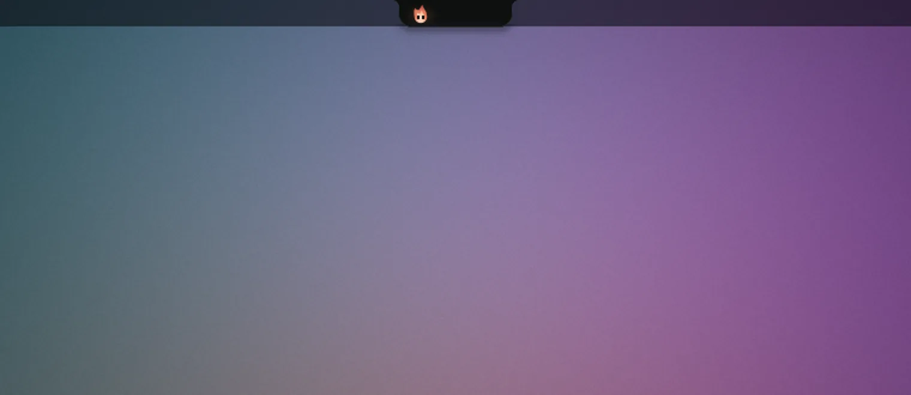
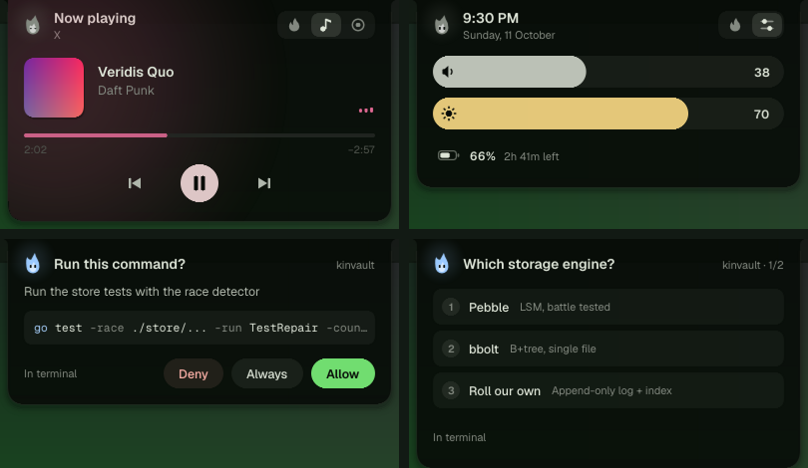
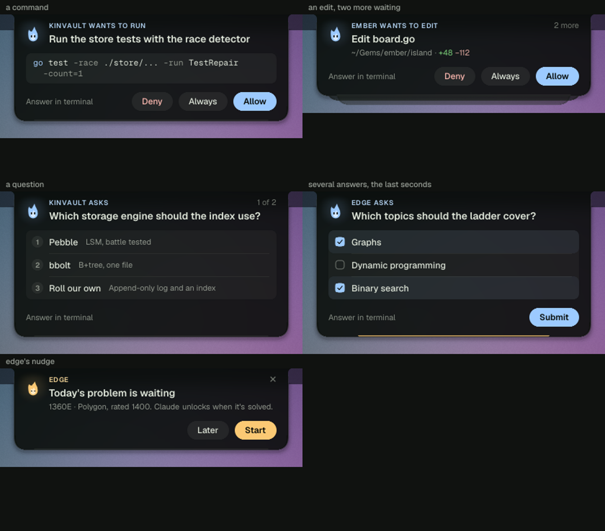
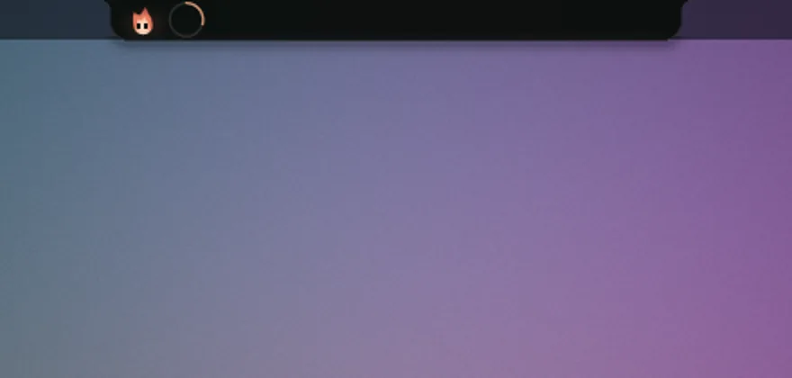
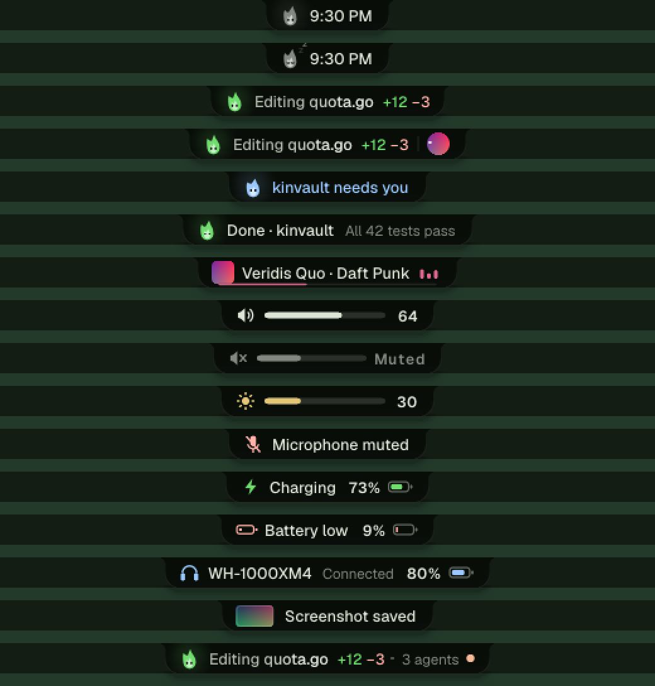
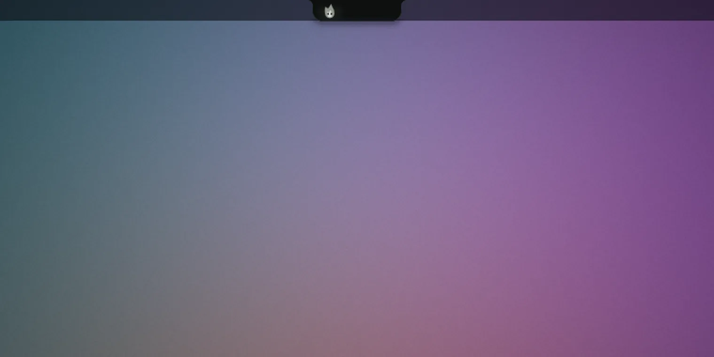

<p align="center">
  
</p>

<p align="center">
  <a href="https://github.com/Tejas242/ember/actions/workflows/ci.yml"></a>
  <a href="https://go.dev"></a>
  <a href="https://wayland.freedesktop.org"></a>
  <a href="https://docs.anthropic.com/en/docs/claude-code"></a>
  
  <a href="LICENSE"></a>
</p>

<p align="center">
  A small pill that hangs from the top of your screen and morphs to show what matters right now:<br>
  what <b>Claude Code</b> is doing and what it needs from you, the song that's playing, and the moment you press a key.<br>
  One native Go binary. No toolkit, no GPU, about 9 MB of memory.
</p>

<p align="center">
  
</p>

<p align="center">
  <a href="#what-it-shows">What it shows</a> ·
  <a href="#alive">Alive</a> ·
  <a href="#install">Install</a> ·
  <a href="#using-it">Using it</a> ·
  <a href="#config">Config</a> ·
  <a href="#how-it-works">How it works</a> ·
  <a href="docs/DESIGN.md">Design</a>
</p>

## Why

You run a few Claude Code sessions in terminals you can't all see. You want to know, at a glance, without switching
windows: *does anything need me, is it going well, what just happened.* Ember answers those three questions from
the top of the screen, and lets you answer Claude's permission requests right there. When nothing's going on it's a
clock with a small flame that breathes, blinks, glances around and falls asleep at night.

## What it shows

### Claude Code

- **At a glance.** The pill names the session at work and how long it has been at it, under a slow band of light.
  It changes only when the situation does, never per tool call. With several sessions, the one you can't see is
  named and the rest count as `+N`. A session that's gone quiet for three minutes turns its timer amber.
- **The card.** Hover the pill and a card drops down. One session is the hero: its task in words, one line of facts
  (*kinvault · 4m in · 3 files +58 −12*), and a live timeline that hangs from Ember on a thin thread. A bead of light
  runs down the thread into each new step. Subagents branch off it. Every other session is one line that says how it
  stands: *Done ·*, *Stopped ·*, *Needs you ·*. Click one to make it the hero.
- **Requests on the island.** Deny, Always or Allow, with Claude's own words as the title and the whole command
  shown (it wraps; it's never cut where an `&& rm -rf` could hide), and a line saying what *Always* would allow.
  Questions from `AskUserQuestion` are a numbered list. Requests that queue up stack under the card. Ember nods when
  you allow and shakes its head when you deny.
- **Done.** When a session finishes where you can't see it, the pill says so with Claude's most informative sentence,
  and a check draws itself. If it stops on an error, it says which in words (*Rate limited*). Either way the outcome
  waits by the clock (*kinvault done*) until you've looked.
- **Never in the way.** A request waits on the island at most 85 s, then Claude asks in the terminal as usual. If
  Ember isn't running, Claude asks in the terminal at once.

<p align="center">
  
</p>

<p align="center">
  
</p>

### Music



Any MPRIS player. In the pill, the cover is a disc with the song as a ring around it. In the card, the cover sits on
a haze of its own colours, with controls, a scrubber you can drag, and the time at both ends. **The equaliser
listens**: while a song plays, Ember reads the output's levels (`parec`, 8 kHz mono) and splits them into low, mid
and high, 25 times a second. Nothing is kept, and it stops when the music does.

<br clear="right">

### Moments


They appear for a moment, then step aside:

- volume, microphone and brightness as you press the keys, with glyphs that follow the level;
- charging (and when it'll be full), unplugged, battery low at 20, 10 and 5 %;
- Bluetooth headphones connecting, with their battery;
- a screenshot, with a shutter flash and its preview (click it to open the file);
- a dot while your screen is being shared.

<br clear="right">

<p align="center">
  
</p>

### Plugins: edge's dashboard

<p align="center">
  
</p>

Parts that belong to tools not everyone has are plugins, asleep until their tool is installed. The first is
**edge**, a practice coach: its day in the pill, its nudges on the island, and a dashboard that opens with a short
choreography. See [Plugins](#plugins).

## Alive

Ember has a small mind. None of it is scripted animation. It is a handful of models running on real time:

- **Affect.** Ember has an energy and a mood that relax toward a baseline, set by the time of day (peaking
  mid-afternoon, lowest around 3 am), by what's running, and by whether you're at the machine. Events nudge them:
  a tool call a little, a finished task brightens the mood, an error darkens it for a while. Energy sets how hard the
  flame flickers, how fast it breathes and how open its eyes are. Mood tints its colour. It casts a soft light on the
  island, brighter when it's lively.
- **Life.** Blinks come at random, about fifteen a minute, sometimes doubled. Glances are random too, and the eyes are
  never perfectly still. Ember looks at things as they appear: a note, the satellite at the pill's end. When the desk has
  been quiet for a while it gets drowsy, then falls asleep (eyes shut, z's rising), and wakes when something happens
  or your pointer comes near.
- **Presence.** Through the compositor's idle notifications it knows when you've stepped away. Sessions that finish or
  ask for you meanwhile aren't shown to an empty room. When you come back, one line tells you what happened:
  *While you were away: kinvault done · ember asked you*.
- **Attention.** What the pill shows is scored, not hard-coded. A running session scores high. A new track scores
  high and then fades as you get used to it. If you're already looking at that session's terminal, the pill shows
  something else and Claude moves to the satellite. A choice holds until a rival clearly beats it, so the pill never
  flickers between close calls. A request waiting on you, and anything you just pressed, always come first.
- **Habits.** It learns which row you reach for in each situation (music while Claude works, say) and puts it
  higher. Older evidence fades, so a new habit takes over within a few uses.
- **Judgement.** "Done" quotes the most informative sentence of Claude's reply (outcomes and numbers win over
  preamble). Notes that arrive together merge ("Done · edge, ember"). A volume change hands a pending note back when
  it's finished. A step running long shows its minutes. A session that went silent for half an hour (a killed Claude
  never says Stop) settles to idle.

Every motion is a spring or a short ease, designed one by one: the card opens with its width leading and a little
overshoot on the drop and folds up first when it closes, rows arrive one after another and glide when they move,
numbers roll, and every pulse keeps one 1.6 s beat. The whole design, with every token and timing, is in
[docs/DESIGN.md](docs/DESIGN.md).

The colours follow Noctalia's wallpaper palette, or your own (`[look]` in the config).

## Install

> [!NOTE]
> Ember is built and used daily on **niri** with the **Noctalia** shell. Other compositors with layer-shell should
> work (the island itself only needs `zwlr_layer_shell_v1`), but they are less tested. Issues and reports are welcome.

Requirements:
- A Wayland compositor with `zwlr_layer_shell_v1` (niri, Hyprland, Sway, river…). **niri** is first-class: focus,
  terminal titles and screen sharing come from its event stream. Hyprland and Sway can focus a session's terminal.
- Go 1.27+ to build.
- Linux with systemd (Ember runs as a user service).
- Optional: [Claude Code](https://docs.anthropic.com/en/docs/claude-code) 2.1+, PipeWire (`wpctl`, `pactl`, `parec`)
  for volume and the listening equaliser, UPower for the battery, BlueZ for headphones, any MPRIS player for music.

```sh
git clone https://github.com/Tejas242/ember && cd ember
make install
```

`make install` puts the binary in `~/.local/bin` and runs `ember install`. That command:
- writes and starts `ember.service` (a systemd user service that starts with your session);
- adds Ember's hooks to `~/.claude/settings.json`, keeping a backup at `settings.json.pre-ember` and leaving your
  other hooks alone;
- writes a default config.

Running it again is safe. Restart open Claude sessions afterwards.

Then check everything:

```sh
ember doctor
```

It checks the service, the compositor protocols (blur, cursor shape), the niri stream, music, volume, brightness,
battery, Claude's hooks and the config, and says what to run for anything missing.

**Your bar.** Ember hangs from the top edge, over the middle of whatever bar you use. Leave the bar's centre empty
and tell Ember its height with `[look] bar_height` (Waybar, say, at 30 px: `bar_height = 30`), so the pill sits on
its line.

**Noctalia.** Ember reads the bar's height from Noctalia itself and follows its wallpaper palette. To keep Noctalia from
showing a second volume and brightness popup, add this to `~/.config/noctalia/services.toml`:

```toml
[osd.kinds]
volume_output = false
volume_input  = false
brightness    = false
media         = false
```

**Blur.** On niri, blur what's behind the island:

```kdl
layer-rule {
    match namespace="^ember$"
    background-effect { blur true; }
}
```

## Using it

| Gesture | Does |
| --- | --- |
| Hover the pill | Drops the card. Leave and it folds back |
| Click the pill | Opens the card. On a request or a "Done", jumps to that terminal |
| Click a moment | Screenshot: opens it. Others open the card |
| Click the satellite | Swaps the second activity (the cover, the little flame) into the pill |
| Click another session in the card | Makes it the hero: its timeline opens |
| Scroll on the pill | Switches what the pill shows |
| Drag the song's progress line | Follows your pointer, even past the island's edge. The seek happens on release |
| Scroll on the music row | Changes the player's volume |
| Middle-click | Play / pause |
| Right-click | Dismisses a moment, the card or a dashboard |
| Click edge's row in the card | Opens edge's dashboard. Leave it, click it or right-click to close |

Commands, for keybindings or scripts:

```
ember open                              open the card
ember close | toggle
ember next | prev                       switch what the pill shows
ember play                              play / pause
ember allow | deny | always             answer the oldest permission request
ember terminal                          hand it back to Claude's own prompt
ember answer opt:N | submit             answer the oldest question
ember dash [name]                       open or close a plugin's dashboard (edge)
```

For example, in niri:

```kdl
binds {
    Mod+Shift+Y { spawn "ember" "allow"; }
    Mod+Shift+N { spawn "ember" "deny"; }
    Mod+Shift+C { spawn "ember" "toggle"; }
}
```

## Plugins

Some of what Ember shows belongs to tools not everyone has. Those parts are plugins: compiled in, but asleep
(no watchers, no rows, no pages) until their tool is installed, and they wake within a minute of it appearing.
`[plugins.<name>] enabled = "auto" | true | false` in the config decides otherwise, and `ember doctor` says which are on.

**edge** (a practice coach for competitive programming; not public yet). Its day sits in the pill and the card, its
notes and buttons on the island, and it has a dashboard (`ember dash edge`, or click its row in the card):

- **the day**: a ring for today's tasks, whether Claude is locked, the streak's flame
- **the problem in progress**: how long you've worked on it, when the next hint unlocks
- **the week** as bars against each day's need, and your **Codeforces rating** over the band edge picks from
- **the year** as a heatmap. Hover a day for what happened
- **solo rate, retention, focus and your weakest focus topic**

It reads edge's live stats file (`$XDG_RUNTIME_DIR/edge/stats.json`) and edge's pushes over the socket. It opens with
a short choreography: the ring sweeps, the bars grow in turn, the rating line draws itself, the year ripples in and
the numbers count up. After that only the flame and the pulses move.

A tool reaches its plugin over the same socket with `{"type":"plugin","name":"<name>","payload":…}`. A new plugin
implements `Plugin` in `island/plugin.go` (detect, start, stop, messages, an optional `Dashboard`) and is listed in
`plugins()`.

## Config

`~/.config/ember/config.toml`, written by `ember install` the first time (never overwritten after). Every key is
optional and changes apply within ten seconds, with no restart. This is the whole file, with the defaults:

```toml
# Ember: changes apply within ten seconds, no restart needed.
# A value Ember can't use keeps its default; `ember doctor` says which.

clock        = "12h"  # 12h | 24h
away_after_s = 120    # idle this long and you're away: news waits and is summed up when you're back

[pill]
idle = "clock"  # what the pill shows when nothing's going on: clock | date | both

[card]
hover_delay_ms = 150  # how long the pointer rests on the pill before the card drops
steps          = 4    # timeline steps, at most (1-4; fewer when other rows need the room)
others         = 3    # sessions listed besides the first; the rest fold into "N more" (0-3)

[moments]
done_s = 6     # how long "Done · project" stays up
osd_ms = 1600  # how long a volume or brightness level stays up

[claude]
answer          = true  # answer permission requests and questions on the island; false: only the terminal asks
wait_s          = 85    # how long a request waits on the island before the terminal asks (5-85)
settle_min      = 30    # a session silent this long is taken as stopped (a killed Claude never says so)
agent_quiet_min = 20    # the same for a subagent

[look]
opacity    = 0.87  # the island's body: 1 is solid, lower lets the blur through (0.3-1)
bar_height = 0     # your bar's thickness in px, so the pill sits on its line; 0 asks Noctalia, else 24 (16-64)
# colours are hex, like "#72dd71"; "" follows Noctalia's theme
green   = ""    # working, done
blue    = ""    # waiting on you
red     = ""    # errors
amber   = ""    # nudges, low battery

[show]
claude      = true  # Claude Code sessions, permission requests, questions
done        = true  # "Done · project" when a session finishes and you're elsewhere
music       = true  # the playing track (MPRIS)
edge        = true  # edge's practice status, if edge runs
osd         = true  # volume, microphone and brightness changes
battery     = true  # charging, fully charged, battery low
devices     = true  # Bluetooth audio connecting and disconnecting
screenshots = true  # a preview when a screenshot is saved
privacy     = true  # a dot while your screen is being shared or recorded

# Plugins run when their tool is installed; set enabled to turn one on or off.
# [plugins.edge]
# enabled = "auto"  # auto | true | false — edge's practice status, cards and dashboard
```

A value Ember can't use, an unknown key or a stray line never stops it: that line keeps its default, and
`ember doctor` says which line and why (`config: line 12: card.steps must be a whole number from 1 to 4`). Doctor also
lists settings newer than your file, so you can copy them from here. `hover_delay_ms` at the top of the file, where
it lived before `[card]`, still works. `EMBER_AWAY_AFTER` (a Go duration, like `20s`) overrides `away_after_s` for
testing.

`[plugins.<name>]` tables belong to plugins. `enabled = "auto"` runs a plugin when its tool is installed; `true` or
`false` decides for it. `[show] edge = false` still turns edge off.

## How it works

- **Claude Code** runs `ember hook <Event>`. Reporting events are sent to the island over
  `$XDG_RUNTIME_DIR/ember.sock` and return at once. A permission request or a question holds the connection open
  until you answer, or for `[claude] wait_s` (85 s); then Claude asks in the terminal. If the hook process goes away because Claude cancelled, the island drops the card.
- **The island** is one `zwlr_layer_shell_v1` surface on the top layer. It reserves no space, so it sits over the
  bar, and takes input only inside its shape. It draws into shared memory with damage tracking. While nothing
  moves, only Ember's few pixels and the live parts (equaliser, progress) are repainted.
- **Everything else is event-driven.** MPRIS and UPower signals over D-Bus, BlueZ for devices, `pactl subscribe` for
  volume, inotify for the backlight and the screenshots folder, and niri's IPC socket for windows and casts. Nothing
  polls.

## Making the pictures

Every image and animation in this README is drawn by Ember's own renderer, from scripted scenes, over a made-up
desktop: nothing is mocked up by hand.

```sh
make gallery   # every state of the island as stills, in ./preview
make docs      # the README's stills, its animations (needs ffmpeg with libwebp) and the banner
```

## Uninstall

```sh
make uninstall    # or: ember uninstall
```

This removes Ember's hooks from Claude's settings and the service. Your config stays.

## Credits

- [Geist and Geist Mono](https://github.com/vercel/geist-font) by Vercel, under the SIL Open Font License 1.1.
- Built for, and alongside, [Claude Code](https://docs.anthropic.com/en/docs/claude-code), whose hooks make the
  whole thing possible.

## License

[MIT](LICENSE)
